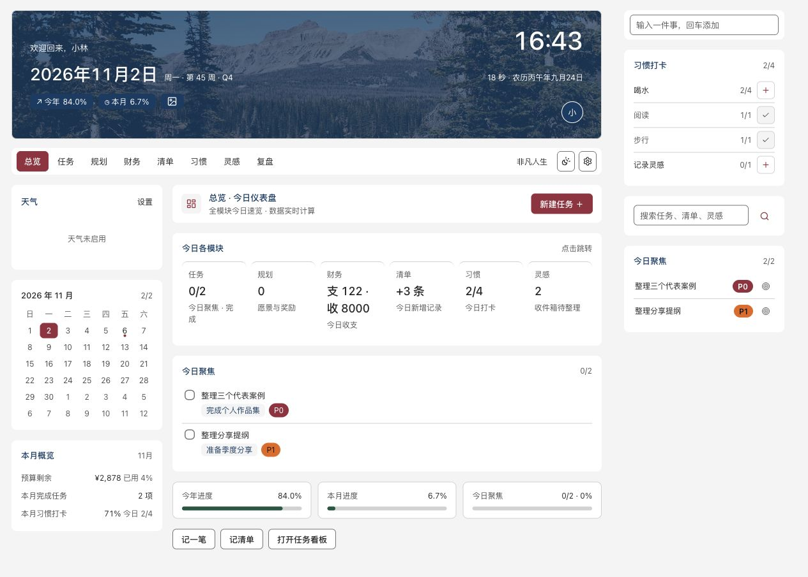

# Feifan Life / 非凡人生

A local Obsidian workspace for projects, tasks, goals, finances, lists, habits, inspiration and reviews.

The current interface is Chinese. Desktop only. A fresh installation starts empty; all screenshots use fictional demonstration data.

[中文说明](README.zh-CN.md) · [Installation](docs/安装与使用.md) · [Privacy](PRIVACY.md) · [All screenshots](docs/screenshots/README.md)



## Features

- Projects and tasks, priorities, subtasks and local Markdown mirrors.
- Goals, visions and progress tracking.
- Personal and business finance ledgers, budgets and records.
- Reading, learning, viewing and inventory lists.
- Habits, inspiration and date-based Markdown reviews.
- Personalized greetings, offline backgrounds and light/dark modes.

## Status

First public release preparation; not yet listed in the Obsidian community directory. Requires Obsidian 1.14.5 or later. Native checks used macOS with Obsidian 1.14.5; Windows and Linux are not yet verified. See the [release checklist](docs/发布准备清单.md) and [acceptance record](docs/普适化验收记录.md).

Version 0.2.0 has no account, payments, AI or enforced quotas. Existing local features are free; future support-edition proposals are drafts, not services currently offered for sale.

## Build and Check

Use Node.js 22 or later and npm:

```sh
npm ci
npm run typecheck
npm test
npm run build
npm run check:release
npm run check:public
```

Build outputs are `build/main.js`, `build/manifest.json` and `build/styles.css`. The build does not install into a vault or copy any user data. Start testing in a new, empty vault; place only those three files in `<configDir>/plugins/feifan-life/`, then enable Feifan Life in Obsidian's community plugin settings.

## Personalization

Open the gear button or the Feifan Life plugin settings. Configure the display name, greeting, theme, background image, optional weather city, review directory and task mirror directory, then save.

- An empty name displays a greeting without an author's name. An empty greeting follows local time.
- Three CC0 background photographs are embedded for offline use; the lake preset is selected on a fresh installation. Optional custom backgrounds must be existing raster images inside the current vault. See [photo credits](assets/backgrounds/README.md).
- Weather is off by default. Enabling it sends the city to `geocoding-api.open-meteo.com` and coordinates to `api.open-meteo.com`. Task and finance records are not sent by this feature.
- Reviews are not read until a directory is configured. It displays date-named Markdown files (`YYYY-MM-DD.md`) in that directory and its subdirectories.
- The review page and command palette include **New review**. Choose a date and folder, enter any of the four sections, and save a normal Markdown note. The first creation suggests `Feifan Life/Reviews` and remembers the chosen folder. Existing same-date notes are opened without overwriting their contents.
- Task Markdown mirrors are created only when the user runs the sync action, under the chosen directory (default `Feifan Life/Tasks`).

## Data and Privacy

Records and settings live in the current vault's `<configDir>/plugins/feifan-life/data.json`. Backups live in the same plugin directory under `backups/`. The actual config directory is read from Obsidian, not fixed to `.obsidian`.

This version has no account, payments, AI service, telemetry or automatic migration from another plugin. Removing the plugin directory also removes these local backups; keep an independent vault backup. Users can copy their own data and backups out of the plugin directory. Do not include them in a source repository or public issue.

The public plugin identifier is `feifan-life`. It has its own data and view identity. Installing it does not import or update any personal edition. Name and identifier availability in the community directory are not yet confirmed.

中文说明：[README.zh-CN.md](README.zh-CN.md). Design rules: [Feifan UI 1.1](docs/10-非凡UI1.1设计与交互规范.md).

## License and Feedback

Copyright (c) 2026 Feifan and respective contributors. The client is licensed under [GPL-3.0-only](LICENSE). Third-party assets retain their own licenses; see [notices](THIRD_PARTY_NOTICES.md).

After the repository is published, use its **Issues** tab for bugs and suggestions. Do not upload private notes, account records, backups or keys. See [contributing](CONTRIBUTING.md), [security reporting](SECURITY.md), and [changelog](CHANGELOG.md).

Publication preparation: [GitHub setup](docs/GitHub仓库与发布配置.md), [release status](docs/开源许可与发布状态.md), [product entitlements](docs/产品权益与授权边界.md). Local workflow files do not establish a successful GitHub Actions run.
