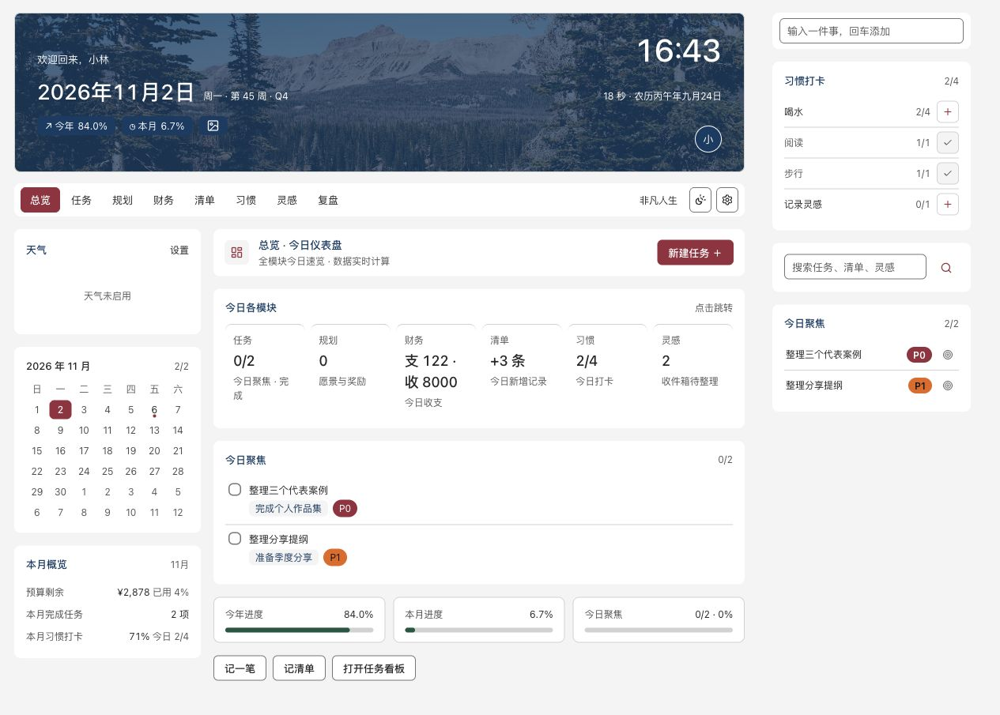

# 非凡人生 / Feifan Life

在 Obsidian 中管理项目、任务、目标、财务、清单、习惯、灵感与复盘。界面为中文，当前仅支持桌面端；安装后从空白记录开始。

[安装与使用](docs/安装与使用.md) · [隐私说明](PRIVACY.md) · [更新记录](CHANGELOG.md) · [全部模块截图](docs/screenshots/README.md)

当前 0.2.0 没有账号、收费、AI 或额度拦截，现有本地功能免费使用。未来支持版的数字与价格仍是草案，不代表已经销售或接通的服务。

## 两套工程的关系

源码本身可以共用，但源码、运行插件和个人数据应分开。当前先创建独立产品副本；通用改进在本工程验证后，再按需要同步到自用版，业务数据不随代码复制。不要长期把两个工程不加检查地整目录互相覆盖。

公开版使用 `feifan-life` 标识和独立视图。所有业务记录和设置写入当前知识库实际配置目录中的 `plugins/feifan-life/data.json`，备份放同目录的 `backups/`，不会自动搜索或导入其他版本的数据。

## 使用与个性化

构建及空库测试步骤见 [英文首页](README.md)。进入插件后，点击导航栏齿轮或打开 Obsidian 的 Feifan Life 设置：

| 设置 | 默认行为 |
|---|---|
| 称呼 | 留空；只显示按本地时间变化的问候，不带作者名字 |
| 问候语 | 留空时自动按时间问候；可填写自己的文字 |
| 显示模式 | 跟随 Obsidian，也可选择日间或夜间 |
| 背景图片 | 内置湖畔森林、雪山晴空和雾山晨光，首次安装默认湖畔森林；也可选纯色或自定义知识库图片 |
| 图片遮罩 | 可调整，保护文字可读性 |
| 天气和城市 | 默认关闭且城市为空；自行启用后才发起天气请求 |
| 复盘目录 | 默认留空，不扫描个人笔记；设置后读取该目录中的日期笔记 |
| 任务镜像目录 | `Feifan Life/Tasks`，只有主动同步时才生成 Markdown |

保存设置后，称呼、问候、显示模式和相关页面立即刷新，重启后保留。头像使用称呼首字符，未填写称呼时显示通用用户图标。

内置照片随插件打包，显示时不联网。作者、来源及 CC0 许可记录见 [图片说明](assets/backgrounds/README.md)。

复盘页右上角及命令面板提供“新建复盘”：填写日期、保存目录及今日完成、问题解决、今日纪念、今日思考，保存为普通 Markdown 笔记。首次创建默认建议 `Feifan Life/Reviews`，保存后记住目录。同一天已经有复盘时只打开原笔记，不覆盖内容。

空白安装的项目、任务、规划、财务记录、习惯、灵感、物资和阅读观影清单全部为空，账本预算为零，不附加演示记录。财务分类可由用户在账本页面添加。

## 联网与数据

当前版本无账号、无收费、无 AI 接口、无遥测。天气是可选联网功能，开启后向 Open-Meteo 城市查询与天气接口发送城市/坐标；默认不发送任务和账目。正式商业化前还需复核天气供应商的商业使用条款。

本地备份保存在插件目录，删除该目录会一并删除备份；请另行备份整个知识库或复制数据与备份到独立位置。损坏数据有有效备份时可恢复，无有效数据时停止启动，不以空数据覆盖。

## 当前发布边界

目前交付的是独立、可构建和测试的产品工程。已选 GPL-3.0-only，要求 Obsidian 1.14.5 及以上；已记录的原生环境为 macOS / Obsidian 1.14.5，Windows 和 Linux 尚未完成原生验收。尚未提交官方审核。后续事项见 [发布准备清单](docs/发布准备清单.md) 与 [当前发布状态](docs/开源许可与发布状态.md)。本工程没有自动安装到作者现用插件的脚本。

已经准备 [GitHub 仓库与发布配置](docs/GitHub仓库与发布配置.md)、[产品权益与授权边界](docs/产品权益与授权边界.md) 和 [宽松免费额度及收费入口草案](docs/免费额度与支持版方案.md)。付款、激活、额度执行及 AI 服务暂缓。

## 许可与反馈

Copyright (c) 2026 Feifan 与各贡献者。客户端代码遵循 [GPL-3.0-only](LICENSE)，第三方素材各自保留原许可，见 [第三方声明](THIRD_PARTY_NOTICES.md)。

仓库公开后可在 Issues 报告问题与建议。提交前阅读 [贡献指南](CONTRIBUTING.md)，安全问题按 [安全反馈](SECURITY.md) 处理。不要上传个人账目、笔记或备份；所有公开截图均由合成数据生成。
