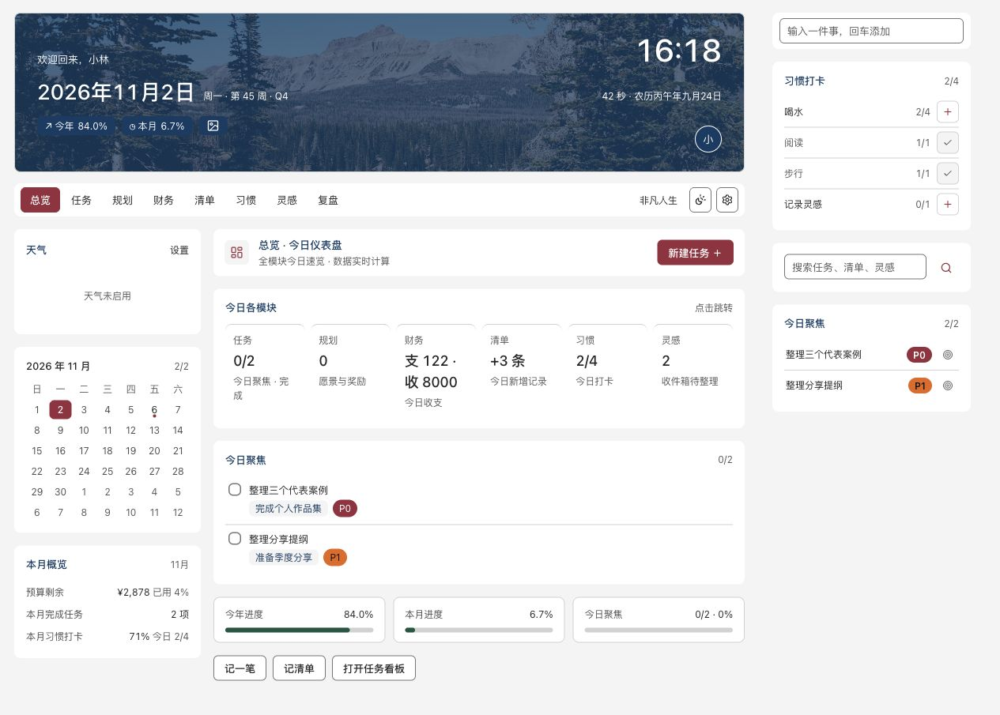
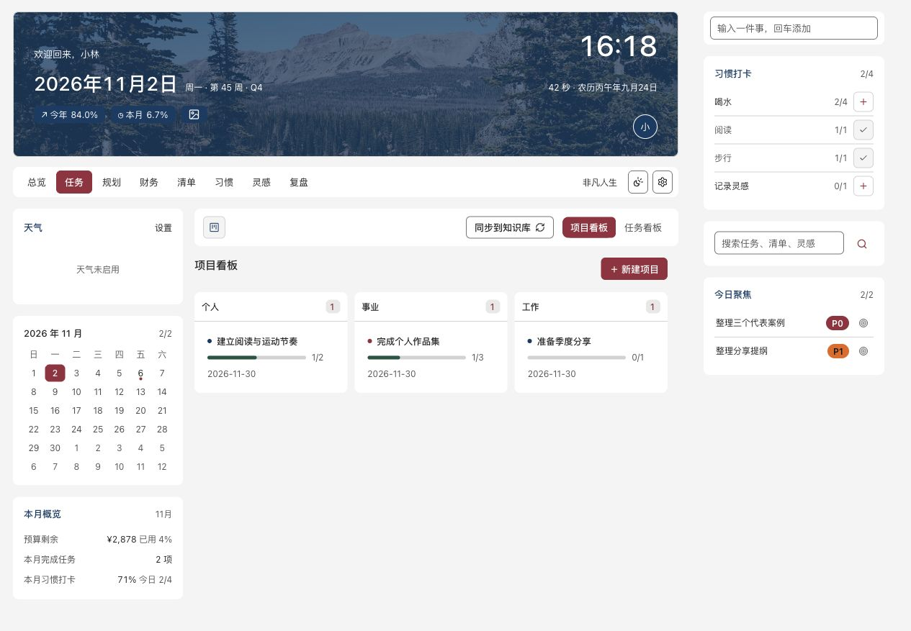
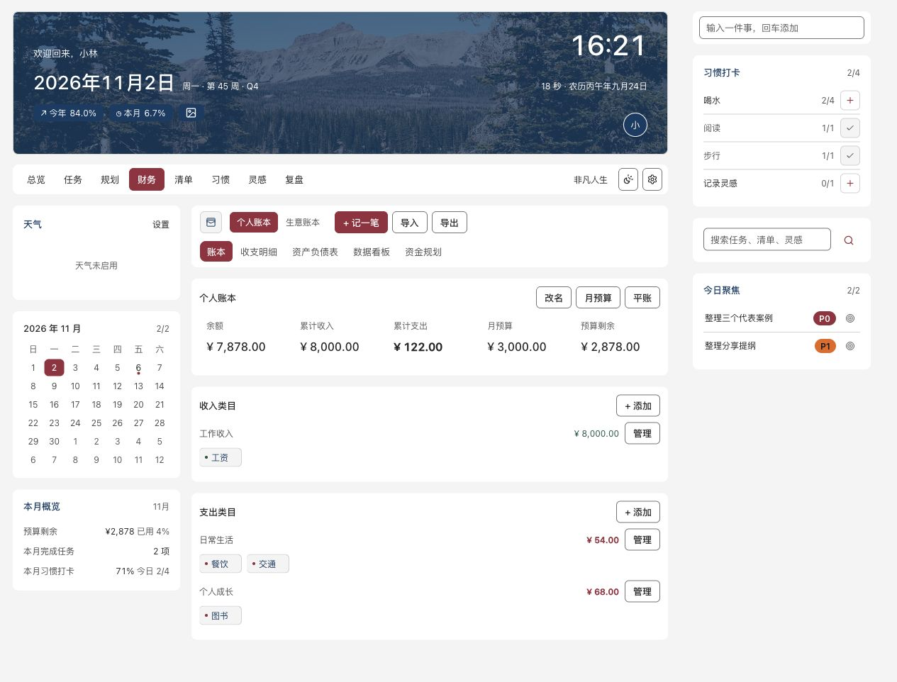

# 模块截图

版本：0.2.0。生成日期：2026-11-02。

全部使用虚构的“小林”、项目、任务、收支、习惯及复盘。图中金额是合成数字，不是作者或用户账目；不会随插件安装导入。这些是实际视图源码在模拟宿主内渲染后的浏览器截图，不是 Obsidian 原生窗口，也不能用来证明原生交互或跨平台兼容。

| 页面 | 截图 |
|---|---|
| 总览 | [日间](overview-light.png)、[夜间](overview-dark.png) |
| 任务 / 项目看板 | [查看](tasks-light.png) |
| 年度规划 | [查看](planning-light.png) |
| 财务 | [查看](finance-light.png) |
| 清单 | [查看](life-light.png) |
| 习惯 | [查看](habits-light.png) |
| 灵感 | [查看](inspiration-light.png) |
| 复盘 | [查看](review-light.png) |







## 再生成

```sh
npm ci
npm run prepare:showcase
node scripts/serve-showcase.mjs
```

生成的静态 HTML 位于被 Git 忽略的 `.showcase/`，只供截图。服务绑定本机 `127.0.0.1:4331`，仅提供预设的九个合成页面，不提供知识库和任意文件访问。若端口已占用，先检查运行的是不是自己的预览服务。

页面路径为上表图片同名的 `.html`，例如 `http://127.0.0.1:4331/overview-light.html`。在浏览器检查照片、文字、字段与布局后保存整页 PNG 到本目录。页面是用于截图的静态快照，操作按钮不连接真实 Obsidian；测试交互请安装插件到测试知识库。

截图使用默认浏览器视口，不将其表述为指定尺寸验收。照片来源见 [背景说明](../../assets/backgrounds/README.md)，图标许可见 [第三方声明](../../THIRD_PARTY_NOTICES.md)。
